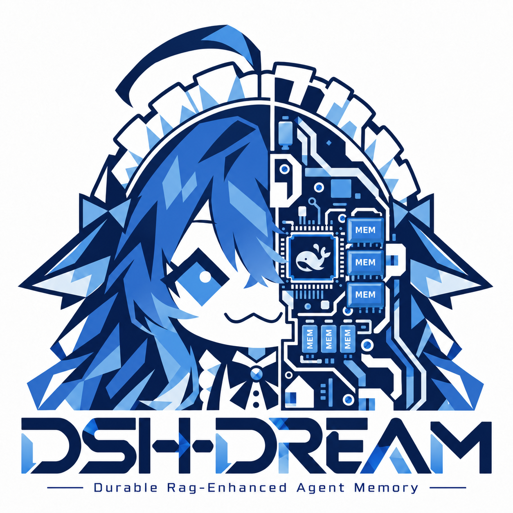

# DSH-DREAM

> Status: v0.2.0 Pre-Alpha

**DSH-DREAM: Durable RAG-Enhanced Agent Memory**

**[English](README_EN.md) | [简体中文](README_CN.md)**



## 1. Overview

DSH-DREAM is a local-first long-term memory layer for companions, assistants, and other
LLM agents. It keeps hard constraints, recent conversation, retrieved memories, and audit
records separate, so the model gets useful context without turning every prompt into an
unreviewable pile of text.

The core idea is **holographic memory**: keep the ordinary moments, not just extracted
“facts”. The complete user message and assistant reply are written unconditionally, while a
`system_fact` remains a highlight tag for that turn. When **Holographic mode** is enabled in
DSH, the Host forces a write at `agent/turn-stopping` even if the agent never calls a memory
tool.

DSH-DREAM ships as both a DSH community plugin and a Python library. Retrieval runs locally
by default; only the short retrieved context is sent to the LLM.

## 2. Quick Start

### A. DSH client (recommended for most users)

**1. Download and extract the release package.**

Download the `release_v0.2.0_prealpha` ZIP from the project's GitHub Releases page (or use the
package supplied by the maintainer), then open PowerShell in the extracted folder:

```powershell
Expand-Archive .\DSH-DREAM-v0.2.0-prealpha.zip -DestinationPath .\DSH-DREAM
cd .\DSH-DREAM
```

**2. Run the installer.**

```powershell
powershell -ExecutionPolicy Bypass -File .\install-agent-memory-plugin.ps1 -Force
```

If PowerShell blocks the script, use the command above rather than changing the machine-wide
execution policy permanently. The installer registers the bundle in the DSH profile and
prepares the local bridge file.

**3. Set the model key (only if you use an LLM).**

Local embedding and retrieval do not require an API key. To let the assistant generate
replies with DeepSeek, set the key **before starting DSH**:

```powershell
$env:DEEPSEEK_API_KEY = "sk-your-key-here"

# Optional: persist it for new terminals
setx DEEPSEEK_API_KEY "sk-your-key-here"
```

Do not commit the key, paste it into a README, or put it in a tracked config file.

**4. Open DSH Settings.**

Go to **Settings → DSH-DREAM** (the panel may also appear under the plugin/settings section
of your DSH build). Turn on:

- **Enable long-term memory**;
- **Holographic mode (forced full memory)** if you want every turn persisted, not only turns
  where the model extracted a fact.

Click **Save**, then send a test message. The first retrieval may take a few seconds while
the local Chroma collection and embedding model are initialized.

### B. Python library (recommended for developers)

```bash
python -m venv .venv
# Windows
.venv\Scripts\activate
# macOS / Linux
# source .venv/bin/activate

python -m pip install -e ".[dev]"
```

Set the key if you want the LLM-assisted demo:

```powershell
$env:DEEPSEEK_API_KEY = "sk-your-key-here"
```

Run the offline demo first:

```bash
python examples/chat_demo.py --demo
```

Then try the persistent interactive chat with the real model:

```bash
python examples/chat_demo.py --llm
```

Minimal Python usage:

```python
from agent_memory import RAGStore

store = RAGStore()  # local BAAI model, .chroma by default
store.add_memory("今天逛街买了一个星巴克的蓝色马克杯。", "user_message")

latest = store.search_memory("蓝色马克杯", top_k=3)
history = store.search_memory("蓝色马克杯的完整历史", top_k=5, timeline_mode=True)
```

Run the test suite:

```bash
python -m pytest -q
```

## 3. Advanced Configuration: External Embedding API

The default embedding model is **`BAAI/bge-small-zh-v1.5`**, which runs locally and needs no
API key. If you prefer a cloud embedding provider, open **Settings → DSH-DREAM → Embedding
model (advanced)** and configure an OpenAI-compatible `/embeddings` endpoint.

| Field | Example | Notes |
|---|---|---|
| Embedding provider | `openai_compatible` | `local` keeps BAAI |
| Embedding model | `text-embedding-3-small` | OpenAI example |
| Embedding API key | `sk-...` | Stored locally; never commit |
| Embedding base URL | `https://api.openai.com/v1` | Must match the provider |

For Zhipu / BigModel, the OpenAI-compatible shape is typically:

```text
Provider:  openai_compatible
Model:     embedding-3
Base URL:  https://open.bigmodel.cn/api/paas/v4
API key:   your Zhipu key
```

Model names and endpoints change; confirm them against the provider's current documentation
before saving.

Keep **“On dimension mismatch, try lossless re-embedding of old data”** enabled if you want
DSH-DREAM to preserve the existing collection when the new model has a different vector
dimension. The store caches the old documents and metadata, recreates the collection, and
writes them back with the new model. IDs, source types, timestamps, and metadata are
preserved; cloud re-embedding consumes tokens, so back up `.chroma` before switching.

## 4. Core Features

- **Four explicit layers.** Anchors (hard constraints), recent window, retrieved memories,
  and audit snapshots stay separate.
- **Holographic memory.** `assistant_message` is on the storage whitelist, alongside
  `user_message`, `system_fact`, and `tool_result`; `model_hint` is always rejected.
  `MemoryAgent` performs unconditional dual write of the full turn, and DSH Holographic mode
  forces a write at `agent/turn-stopping`.
- **State-slot conflict detection, not blanket latest-wins.** Only a direct location/state
  change (“key in the shoe cabinet” → “key in the flower pot”) is collapsed. A sequence such
  as “bought a mug → broke it → bought a replacement” is preserved.
- **Timeline retrieval.** `timeline_mode=True` skips conflict collapsing and returns the
  relevant raw memories in ascending timestamp order.
- **Local-first by default.** Retrieval uses local Chroma plus BM25; the LLM only sees a
  compact evidence block, not the whole database.
- **Auditable by design.** Each request records retrieved chunk IDs, a window hash, and the
  anchor version.
- **Safety boundaries.** Anchor payloads are capped at 2000 tokens; retrieved text is
  untrusted background evidence; user text is delimiter-isolated.

## 5. Architecture and Measured Results

### Retrieval: RRF + exact Flat

`RAGStore.search_memory()` runs two independent retrievers for every query:

1. **Vector retrieval** — below `flat_max_records` (default **200,000**), a NumPy **exact
   cosine Flat scan**. This is 100% recall by construction, not an ANN approximation. Only
   collections above 200,000 records fall back to Chroma HNSW.
2. **Full-corpus BM25** — Chinese bigrams plus ASCII tokens, ranking the whole corpus.

The ranks are fused with reciprocal-rank fusion (RRF):

```text
score = sum(1 / (60 + rank))
```

There is no hardcoded keyword table and no “HNSW-first” shortcut. `search_vector()` is
available for vector-only diagnostics.

### Time and conflict: state slots + timeline mode

Each record has a millisecond `timestamp_ms`. The store does not apply unconditional
latest-wins. It detects **state-slot conflicts** only: the same location/state predicate with
different values. Direct state changes collapse to the newest version; action sequences do
not. For history questions, pass `timeline_mode=True` to return the relevant raw memories in
ascending order. `MemoryAgent` uses the query-rewrite LLM's `intent: "latest" | "timeline"`
decision to choose the mode automatically.

### 100k A/B: RAG vs. a 1M-token bare run

The 100,000-memory A/B experiment compared a 1M-token truncated bare run (A0), a sharded
map-reduce baseline (A1), and RRF + Flat RAG (B). RAG used **1,368 input tokens** versus
**2,850,000** for A0, a ratio of about **1/2083**. On the input-token billing basis, that is
about **1/2083 of the bare-run cost**; the actual API bill was **$0.000377** for B versus
**$0.427713** for A0. End-to-end latency fell from **46.4 s** (A1) to **1.2 s** (B).

| Metric | A0: 1M truncated | B: RRF + Flat |
|---|---:|---:|
| Input tokens | 2,850,000 | **1,368** |
| Input-token ratio | 1× | **≈ 1/2083** |
| Actual API cost | $0.427713 | **$0.000377** |
| End-to-end latency | 17.9 s | **1.2 s** |
| Strict answer accuracy | 0/3 | **3/3** |

### 10k D group: the blue mug stress test

A 10,000-record daily-trivia corpus placed three ordinary facts at records 2,500 / 5,000 /
7,500. The diary method was limited to 200 Chinese characters per 100-record group; RAG used
`timeline_mode=True, top_k=5`.

| Method | Result |
|---|---|
| 200-character diary summaries | **Lossy** — brand, purchase, and replacement details were lost |
| RAG timeline mode | **Lossless** — returned T1 → T2 → T3 and reconstructed “bought → broke → bought a replacement” |

**For full experiment details, see [docs/experiments/AB-100K-KEY-2026/README.md](docs/experiments/AB-100K-KEY-2026/README.md).**

### Repository layout

```text
DSH-DREAM/
├── package.json                 # DSH community root manifest (dsh.bundle)
├── cordis.patch.yml             # root bundle patch
├── screenshots.json             # storefront screenshots
├── manifest.json
├── pyproject.toml
├── src/agent_memory/
├── dsh_plugin/
│   ├── package.json
│   ├── cordis.patch.yml
│   ├── index.js
│   ├── client.js
│   ├── turn_bridge.py
│   ├── locale/
│   ├── assets/
│   └── icon.png
├── tests/
├── examples/
├── experiments/ab_100k/
├── data/plugins/
├── docs/
│   ├── assets/DSH-DREAM.png
│   └── experiments/AB-100K-KEY-2026/
└── logo/
    ├── DSH-DREAM.png
    ├── DSH-DREAM.svg
    ├── DSH-DREAM_icon.png
    └── DSH-DREAM_icon.svg
```

## Acknowledgments

Special thanks to BH4FKW for providing the core theoretical framework, technical path design, and rigorous review throughout this project.

特别致谢 BH4FKW 为本项目提供的核心技术路径指导、架构设计建议与严谨评审。

## License

MIT. See [LICENSE](LICENSE).

---

© 2026 DSH-DREAM: Durable RAG-Enhanced Agent Memory.
