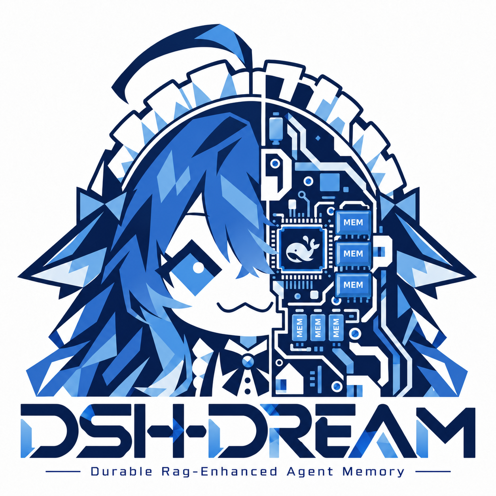

# DSH-DREAM

> Status: v0.5.0 Pre-Alpha

**DSH-DREAM: Durable RAG-Enhanced Agent Memory**

**[English](README_EN.md) | [简体中文](README_CN.md)**



## 1. 项目简介

DSH-DREAM 是一个本地优先的长期记忆层，面向陪伴型 AI、助理型 Agent 和其他 LLM 应用。它把硬约束、最近对话、检索记忆和审计记录分开，让模型拿到有用的上下文，而不是把每轮对话都堆成一大段无法审查的文本。

核心理念是**全息记忆**：保留普通日常，而不只是抽取出来的“事实”。每轮完整的用户消息和助手回复都会无条件写入；`system_fact` 只是这一轮的高亮标签。在 DSH 中开启**全息模式**后，Host 会在 `agent/turn-stopping` 强制写入整轮，即使 Agent 从未调用记忆工具。

DSH-DREAM 同时提供 DSH 社区插件和 Python 库。检索默认在本地运行，只有很短的检索证据会交给 LLM。

## 2. 快速开始

**Prerequisites:** Python 3.10+ required. Run `pip install -e ".[dev]"` first.

### 方式 A：在 DSH 客户端部署（推荐给普通用户）

**1. 下载并解压发布包。**

从项目的 GitHub Releases 页面下载 `release_v0.2.0_prealpha` ZIP（或使用维护者提供的包），在解压目录打开 PowerShell：

```powershell
Expand-Archive .\DSH-DREAM-v0.2.0-prealpha.zip -DestinationPath .\DSH-DREAM
cd .\DSH-DREAM
```

**2. 运行安装脚本。**

```powershell
powershell -ExecutionPolicy Bypass -File .\install-agent-memory-plugin.ps1 -Force
```

如果 PowerShell 拦截脚本，请使用上面的命令，不要为了安装永久修改整台机器的执行策略。脚本会把 bundle 注册到 DSH profile，并准备本地桥接配置文件。

**3. 配置模型 Key（只有用 LLM 时才需要）。**

本地 Embedding 和检索不需要 API Key。若要让助手用 DeepSeek 生成回复，请在**启动 DSH 之前**设置：

```powershell
$env:DEEPSEEK_API_KEY = "sk-your-key-here"

# Optional: persist it for new terminals
setx DEEPSEEK_API_KEY "sk-your-key-here"
```

不要把 Key 提交到仓库、写进 README 或放进会被 Git 跟踪的配置文件。

**4. 打开 DSH 设置。**

进入 **Settings → DSH-DREAM**（有些 DSH 版本会放在插件/设置区域）。打开：

- **启用长期记忆 / Enable long-term memory**；
- 如果希望每轮都完整保存，再打开 **全息模式 / Holographic mode (forced full memory)**。

点击 **Save**，然后发送一条测试消息。第一次检索可能需要几秒钟初始化本地 Chroma 集合和 Embedding 模型。

### 方式 B：作为 Python 库部署（推荐给开发者）

```bash
python -m venv .venv
# Windows
.venv\Scripts\activate
# macOS / Linux
# source .venv/bin/activate

python -m pip install -e ".[dev]"
```

如果要运行带 LLM 的示例，先设置 Key：

```powershell
$env:DEEPSEEK_API_KEY = "sk-your-key-here"
```

先跑离线示例：

```bash
python examples/chat_demo.py --demo
```

再运行接真实模型的持久化交互 Demo：

```bash
python examples/chat_demo.py --llm
```

最小 Python 用法：

```python
from agent_memory import RAGStore

store = RAGStore()  # local BAAI model, .chroma by default
store.add_memory("今天逛街买了一个星巴克的蓝色马克杯。", "user_message")

latest = store.search_memory("蓝色马克杯", top_k=3)
history = store.search_memory("蓝色马克杯的完整历史", top_k=5, timeline_mode=True)
```

运行测试：

```bash
python -m pytest -q
```

## 3. 进阶配置：接入外部 Embedding API

默认 Embedding 模型是 **`BAAI/bge-small-zh-v1.5`**，在本地运行，不需要 API Key。如果想使用云端 Embedding，打开 **Settings → DSH-DREAM → Embedding model (advanced)**，配置 OpenAI 兼容的 `/embeddings` 接口。

| 字段 | 示例 | 说明 |
|---|---|---|
| Embedding Provider | `openai_compatible` | `local` 继续使用 BAAI |
| Embedding Model | `text-embedding-3-small` | OpenAI 示例 |
| Embedding API Key | `sk-...` | 只存本机，绝不提交 |
| Embedding Base URL | `https://api.openai.com/v1` | 必须与服务商匹配 |

智谱 / BigModel 的 OpenAI 兼容配置通常形如：

```text
Provider:  openai_compatible
Model:     embedding-3
Base URL:  https://open.bigmodel.cn/api/paas/v4
API key:   your Zhipu key
```

模型名和 endpoint 会更新，保存前请以服务商当前文档为准。

如果你想在切换模型后保留旧数据，请保持 **“On dimension mismatch, try lossless re-embedding of old data”** 开启。DSH-DREAM 会缓存旧 documents/metadatas，重建集合，再用新模型写回；ID、来源类型、时间戳和 metadata 都会保留。云端重嵌入会消耗 Token，切换前建议先备份 `.chroma`。

## 4. 核心特性

- **四层边界。** 锚点（硬约束）、最近窗口、检索记忆和审计快照各自独立。
- **全息记忆。** `assistant_message` 已加入白名单，与 `user_message`、`system_fact`、`tool_result` 并列；`model_hint` 永远拒绝。`MemoryAgent` 会无条件双写完整回合；DSH 全息模式会在 `agent/turn-stopping` 强制写入。
- **状态槽位冲突检测，而不是无差别 latest-wins。** 只有直接的位置/状态变化（“钥匙在鞋柜” → “钥匙在花盆”）才会折叠；像“买了杯子 → 摔碎 → 买新的补上”这样的动作序列会完整保留。
- **时间线检索。** `timeline_mode=True` 会跳过冲突折叠，按时间戳升序返回相关原始记忆。
- **默认本地优先。** 检索使用本地 Chroma + BM25；LLM 只拿到紧凑的证据块，而不是整个数据库。
- **可审计。** 每次请求记录召回 chunk、窗口哈希和锚点版本。
- **安全边界。** 锚点载荷硬上限 2000 Token；检索文本是不可信背景；用户文本用分隔符隔离。

## 5. 架构与实测数据

### 检索：RRF + 精确 Flat

`RAGStore.search_memory()` 对每次查询同时跑两条独立检索：

1. **向量检索**：集合小于 `flat_max_records`（默认 **200,000**）时，使用 NumPy **纯暴力精确余弦扫描（Flat）**，构造上 100% 召回，不是 ANN 近似；只有超过 20 万条才回退 Chroma HNSW。
2. **全语料 BM25**：中文二元词 + ASCII 词，直接对全语料排序。

两路排名用倒数排名融合（RRF）：

```text
score = sum(1 / (60 + rank))
```

没有硬编码关键词表，也没有“先走 HNSW”的捷径。需要纯向量诊断时可以调用 `search_vector()`。

### 时间与冲突：状态槽位 + 时间线模式

每条记录都有毫秒级 `timestamp_ms`。系统不做无条件 latest-wins，只检测**状态槽位冲突**：同一位置/状态谓词、但值不同。直接状态变化折叠到最新版本；动作序列不折叠。询问历史时传 `timeline_mode=True`，按时间升序返回相关原始记忆。`MemoryAgent` 会根据查询改写 LLM 的 `intent: "latest" | "timeline"` 自动选择模式。

### 10 万级 A/B：RAG 对比 1M Token 裸跑

10 万条记忆的 A/B 实验对比 1M 截断裸跑（A0）、分片 map-reduce 基线（A1）和 RRF + Flat RAG（B）。RAG 使用 **1,368 输入 Token**，A0 使用 **2,850,000**，约为 **1/2083**。按输入 Token 计费口径，约为裸跑成本的 **1/2083**；实际 API 账单 B 为 **$0.000377**，A0 为 **$0.427713**。端到端耗时从 A1 的 **46.4 秒** 降到 B 的 **1.2 秒**。

| 指标 | A0：1M 截断 | B：RRF + Flat |
|---|---:|---:|
| 输入 Token | 2,850,000 | **1,368** |
| 输入 Token 比例 | 1× | **≈ 1/2083** |
| 实际 API 成本 | $0.427713 | **$0.000377** |
| 端到端耗时 | 17.9 s | **1.2 s** |
| 严格正确率 | 0/3 | **3/3** |

### 10k D 组：蓝色马克杯压力测试

10,000 条日常琐事语料中，第 2,500 / 5,000 / 7,500 条埋入三条普通细节。日记法每 100 条限制 200 字；RAG 使用 `timeline_mode=True, top_k=5`。

| 方法 | 结果 |
|---|---|
| 200 字日记摘要 | **有损**：品牌、购买、补买细节丢失 |
| RAG 时间线模式 | **无损**：按 T1 → T2 → T3 返回，完整还原“买 → 摔碎 → 补买” |

**完整实验细节见 [docs/experiments/AB-100K-KEY-2026/README.md](docs/experiments/AB-100K-KEY-2026/README.md)。**

### 仓库目录

```text
DSH-DREAM/
├── package.json                 # DSH community root manifest (dsh.bundle)
├── cordis.patch.yml             # root bundle patch
├── screenshots.json             # storefront screenshots
├── manifest.json
├── pyproject.toml
├── src/agent_memory/
├── dsh_plugin/
│   ├── package.json
│   ├── cordis.patch.yml
│   ├── index.js
│   ├── client.js
│   ├── turn_bridge.py
│   ├── locale/
│   ├── assets/
│   └── icon.png
├── tests/
├── examples/
├── experiments/ab_100k/
├── data/plugins/
├── docs/
│   ├── assets/DSH-DREAM.png
│   └── experiments/AB-100K-KEY-2026/
└── logo/
    ├── DSH-DREAM.png
    ├── DSH-DREAM.svg
    ├── DSH-DREAM_icon.png
    └── DSH-DREAM_icon.svg
```

## 致谢

特别致谢 BH4FKW 为本项目提供的核心技术路径指导、架构设计建议与严谨评审。

Special thanks to BH4FKW for providing the core theoretical framework, technical path design, and rigorous review throughout this project.

## 依赖与致谢 (Dependencies & Credits)

本项目离不开以下优秀的开源项目和模型（本项目不捆绑打包，均通过标准包管理器动态安装）：

**Python 核心依赖:**

- [ChromaDB](https://github.com/chroma-core/chroma) (Apache-2.0) - 本地向量数据库
- [sentence-transformers](https://github.com/UKPLab/sentence-transformers) (Apache-2.0) - 向量化模型框架
- [PyTorch](https://github.com/pytorch/pytorch) (BSD-3-Clause) - 深度学习底层框架
- [rank-bm25](https://github.com/dorianbrown/rank_bm25) (Apache-2.0) - BM25 关键词检索算法
- [latex2mathml](https://github.com/roniemartinez/latex2mathml) (MIT) - LaTeX 公式转换

**AI 模型:**

- [BAAI/bge-small-zh-v1.5](https://huggingface.co/BAAI/bge-small-zh-v1.5) (MIT) - 本地中文向量化模型

**DSH 插件生态依赖:**

- [@deepseek-ai/schemastery](https://github.com/deepseek-ai) (DSH Official) - DSH 原生 UI 渲染引擎

感谢这些开源先驱，让赛博记忆得以实现。

## 许可证

MIT，见 [LICENSE](LICENSE)。

---

© 2026 DSH-DREAM: Durable RAG-Enhanced Agent Memory.
